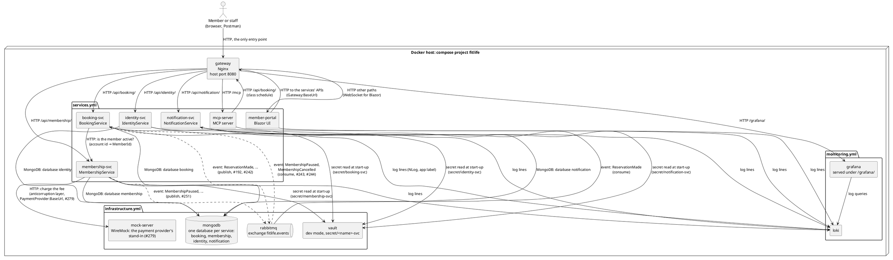

# Deployment: where everything runs

One picture of the local compose stack (`deploy/compose/`): the containers under their compose names, the gateway as the only way in, one database per service, and what travels on each arrow. The bounded contexts and why they talk the way they do are in `docs/domain/CONTEXT-MAP.md`; this page only shows where the parts run.

Drawn from `deploy/compose/*.yml`, `deploy/compose/nginx/default.conf.template` and the services' code on `develop`, 27 November 2026. A dashed arrow is a **planned link**: the stack doesn't use it yet, because the code or the compose setting it needs isn't there (the issue is in brackets). `deploy/compose/deployment-diagram.test.sh` fails when a compose service has no box here or is marked as planned; it doesn't check the arrows.

## REST

Everything from outside comes through `gateway`, on host port 8080. It sends `/api/<context>/<path>` to that context's service as `/<path>`, `/mcp` to the MCP server, `/grafana/` to Grafana, and other paths to the member portal; `/health` it answers itself. MongoDB, RabbitMQ, Vault and Loki also have host ports, but only on `127.0.0.1`, for developers: they aren't public. Inside the stack a service is reached by its compose name, e.g. `http://membership-svc:8080`. That is how Booking asks Membership whether a member is active, before a reservation (CONTEXT-MAP section 4). The member portal and the MCP server call the services' APIs through the gateway. The routes and the upstream variables are described in `deploy/compose/README.md`, "The gateway".

## Events

The design: a context that must not wait for another publishes an event to RabbitMQ, and each consumer reads it from its own queue (the events and who consumes them: CONTEXT-MAP section 5). Today `notification-svc` consumes `ReservationMade` from its queue `notification.reservation-made`, but no service publishes it yet: Booking's publisher is #192. Booking's other events are #242, Membership's are #251, and Booking consumes Membership's in #243 and #244. The shared publisher and consumer are in `libs/FitLife.Messaging`, and the event schemas in `contracts/events/`.

## In Azure

Production is one container group on Azure Container Instances, not a compose stack. Caddy is in front with HTTPS on 443, the only public port, and passes on to the same Nginx. The containers share `localhost`, so each listens on its own port and Nginx reaches them at `http://127.0.0.1:<port>` instead of by name. Loki and Grafana aren't in the group today. See `deploy/azure/README.md`.
