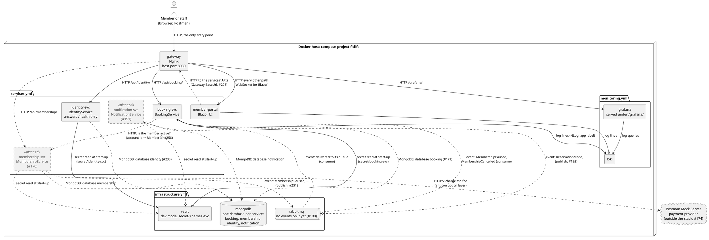

# Deployment: where everything runs

One picture of the local compose stack (`deploy/compose/`): the containers under their compose names, the gateway as the only way in, one database per service, and what travels on each arrow. The bounded contexts and why they talk the way they do are in `docs/domain/CONTEXT-MAP.md`; this page only shows where the parts run.

Drawn from `deploy/compose/*.yml` and `deploy/compose/nginx/default.conf.template` on `develop`, 25 November 2026. A dashed box is a **planned** container: it isn't in the compose files yet, and the issue that adds it is in brackets. A dashed arrow is a **planned link**: one end or both may exist today, but the code that uses the link doesn't yet (the issue is in brackets where one is known).

## REST

Everything from outside comes through `gateway`, on host port 8080. It sends `/api/<context>/<path>` to that context's service as `/<path>`, `/grafana/` to Grafana, and every other path to the member portal. MongoDB, RabbitMQ, Vault and Loki also have host ports, but only on `127.0.0.1`, for developers: they aren't public. Inside the stack a service is reached by its compose name, e.g. `http://membership-svc:8080`. That is how Booking will ask Membership whether a member is active (CONTEXT-MAP section 4), once its Membership client exists (#256). The routes and the upstream variables are described in `deploy/compose/README.md`, "The gateway".

## Events

Planned: a context that must not wait for another will publish an event to RabbitMQ, and each consumer will read it from its own queue. Booking and Membership publish, and Notification and Booking consume, as listed in CONTEXT-MAP section 5. Today the `rabbitmq` container runs, but no service publishes or consumes yet: the shared RabbitMQ code with the exchange and the correlation ID header is #190, the first event schema in `contracts/events/` is #92, and the first publisher is #192.

## In Azure

Production is one container group on Azure Container Instances, not a compose stack. Caddy is in front with HTTPS on 443, the only public port, and passes on to the same Nginx. The containers share `localhost`, so each listens on its own port and Nginx reaches them at `http://127.0.0.1:<port>` instead of by name. Loki and Grafana aren't in the group today. See `deploy/azure/README.md`.
