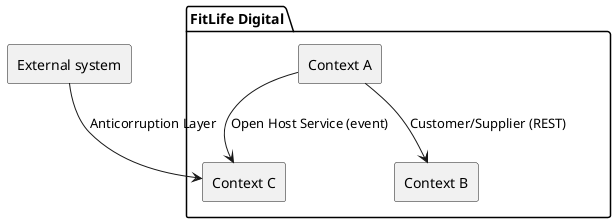

# Context map: FitLife Digital

> Use the course worksheet `itarkitektur notes/.../Modul 4/Opgaver/HaaV-domænemodel.md` as scratch paper in the workshop, and put the results here.
> This file is a **group decision**. To change it, open an issue and write an ADR (`METHODOLOGY.md` section 11).

## 1. Core capability

> **<Name>**: the ability to ... *(what the business can do, not how or who)*

Why it is core: it creates a real competitive advantage, it is hard to copy, and it supports the strategy directly. Give one line for each.

## 2. Subdomains

| Subdomain | Responsibility | Type | Build / buy / integrate | Why |
|---|---|---|---|---|
| | | Core | Build | |
| | | Supporting | Build simply | |
| | | Generic | Buy or integrate | |

## 3. Bounded contexts

One context = one service in `src/<Service>/` = one database. Each context has its own `src/<Service>/CONTEXT.md`.

| Context | Service | Subdomain(s) | Owns data about | Key terms (see `GLOSSARY.md`) |
|---|---|---|---|---|
| | | | | |
| | | | | |
| | | | | |

## 4. Relations

Patterns: Partnership, Shared Kernel, Customer–Supplier, Conformist, Anticorruption Layer (ACL), Open Host Service / Published Language, Separate Ways.

| Upstream | Downstream | Pattern | How (REST / event) | Why this pattern |
|---|---|---|---|---|
| | | | | |
| | | | | |

## 5. Events that cross a context boundary

Each event has a JSON Schema in `contracts/events/` and is tested against it in CI.

| Event (past tense) | Published by | Consumed by | What the consumer does | Schema |
|---|---|---|---|---|
| | | | | `contracts/events/<event>.schema.json` |

## 6. Decisions

| Decision | ADR |
|---|---|
| Why these bounded contexts | `docs/adr/00X-bounded-contexts.md` |
