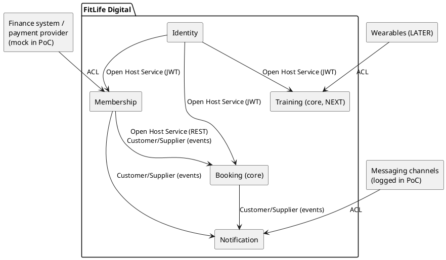

# Context map: FitLife Digital

> **Status: proposed, not decided.** Draft for the group session on issue #2. The answers below are Jesper's proposal (2026-11-23) and must be confirmed by the group. Nothing here is decided until ADR 007 says `accepted`. Open questions: [ADR 007](../adr/007-bounded-contexts.md#questions-for-the-group-session).
> **Agents:** don't build on rows marked with an open question (Q5, Q6, Q8, Q9). Which context the PoC builds first is decided in #18, not here.
> This file is a **group decision**. To change it, open an issue and write an ADR (`METHODOLOGY.md` section 11).
> Method: IT-arkitektur M4, *Læringsguide M4.01* (its examples use the course's practice company HaaV; we apply the method to FitLife) and the worksheet *HaaV-domænemodel (Skabelon)*.

**Sources, short form.** `[PB p. N]` = *F25v Projektbeskrivelse – Fase 1 og 2*. `[M4.01 p. N]` = *Læringsguide M4.01 – HaaVs forretningsdomæne*. `[M10.03]` = *Læringsguide M10.03 – Godkendelse med JWT*. `[I1]`–`[I4]` = the group's four simulated interviews with synthetic informants (27 Oct 2026): I1 Freja, I2 Mikkel, I3 Amira, I4 Jonas. **Group choice** = a design decision of ours, not a fact from the case.

## Three kinds of truth

Agents: keep these apart. Most wrong code comes from mixing them.

| Layer | Question | Example |
|---|---|---|
| The case (AS-IS) | What does FitLife have today? | A membership system from 2012 handles payment and key fobs [PB p. 4] |
| The target architecture (TO-BE) | What have we decided FitLife should have? | Our own Membership and Access contexts, built from scratch. The 2012 system is retired after a one-time migration of the members |
| The PoC | What actually runs in our code? | No 2012 system and no integration with it. Members are created in our own Membership service; until it exists, a Postman Mock Server stands in for member registration (#35) |

## 1. Core capability and core subdomains

> **Core capability:** the ability to give every member a personal relationship with the trainers and instructors they know, on classes and in personal training, in the centre and digitally.

| Criterion [M4.01 p. 4] | Met? | Why |
|---|---|---|
| Creates a real competitive advantage | Yes | Skilled trainers with high customer satisfaction and a personal relationship with customers are FitLife's strengths [PB p. 4–5]. Three of four informants name the trainers or instructors as their reason to stay [I1, I3, I4] |
| Hard to copy | Yes | It lives in people and local relationships. The competitors win on price and opening hours [I1, I2] |
| Supports the strategy directly | Yes | The hybrid model must support community, motivation and flexibility "uden at fjerne det menneskelige aspekt" [PB p. 4] |

**Core subdomains (Q1, option A, as in the target architecture from part 1):** class scheduling and booking, and personal training. That is the maximum of two [M4.01 p. 5].

**The reverse test** [M4.01 p. 4]: if FitLife did this as well as everyone else, would anyone still choose FitLife? For personal training, clearly yes. For booking, the answer only holds if the argument is the local class with a known instructor, not the booking software: competitors already offer booking in an app [I1]. The report must make that argument. Options B and C and why they were not chosen are in ADR 007.

## 2. Subdomains

**Build or integrate** follows the group's line (proposal, Q8): we build FitLife Digital ourselves with the tools from the courses and from Azure, and buy nothing at this stage. What lies outside FitLife Digital, such as the finance system, is integrated. This conflicts with principle P5 in the target architecture from part 1, which says that payment, key fobs and messaging channels are bought or integrated. Q8 settles it.

| Subdomain | Responsibility | Type | Build / integrate | Why |
|---|---|---|---|---|
| Class scheduling and booking | One class schedule for all six centres; book, cancel, join a waitlist | Core | Build | The local class with a known instructor. Also the informants' biggest shared pain point [I1–I4] |
| Personal training | Programmes, sessions and follow-up between a member and their personal trainer | Core | Build | The relationship with the trainer is the core capability. Today the data lives in each trainer's own Excel sheet [PB p. 4; I2, I3] |
| Membership administration | Join, pause, change and cancel a membership digitally | Supporting | Build from scratch | Replaces the 2012 system's membership part [PB p. 4]. The informants ask for pause and flexible memberships [I3, I4], which the single membership type doesn't offer [PB p. 3] |
| Access control | Who may enter a centre: key fobs and check-ins | Supporting | Build from scratch (NEXT) | Replaces the 2012 system's key fob part [PB p. 4], so the new platform can at least do what the old one did. The door hardware asks Access; it is not part of our model |
| Consent for health data | Members' consent to share training and health data, and a log of who saw it | Supporting | Build together with personal training; minimal in the PoC | Pulse and weight are health data [PB p. 4]. Principle P4 in the target architecture |
| Member communication | Tell the right members about cancellations and changes | Supporting | Build simply | Who gets a message follows from the bookings. How SMS and e-mail are sent is open; in the PoC messages are only logged |
| Identity and access | Log-in, roles and tokens | Generic | Build simply ourselves | Our own `IdentityService` with JWT, as taught in IT-arkitektur M10 [M10.03]. Small in the PoC. No MitID |
| Payment and finance | Charging the membership fee, accounting | Generic | Integrate (external) | Outside FitLife Digital. FitLife's finance system and a payment provider; mocked in the PoC |
| Insight | Reports on bookings, attendance and churn per centre | Supporting | Build simply, later | Built on data the other contexts already create |
| Engagement | Challenges, groups and points | Supporting | Later | From the case's idea for FitLife Digital [PB p. 5]; not in the first phases |

At most two subdomains are core: "hvis alt er core, er intet core" [M4.01 p. 5].

### Not in this version (deliberate choice)

- **Live-streamed and on-demand classes and videos.** The case's idea for FitLife Digital includes them [PB p. 5], and the online classes during corona were "overraskende populært" [PB p. 3]. We leave them out because the core capability is the relationship with trainers and instructors in the centre, and the first versions strengthen that. Streaming and video content are a separate effort. (Proposed reason, the group confirms the wording.)
- **MitID.** Not part of the target architecture or the PoC.

## 3. Bounded contexts

One context = one service in `src/<Service>/` = one database. Each context gets its own `src/<Service>/CONTEXT.md` (DDD_PLAN step 3). Phase: NOW = the first phase; NEXT and LATER = later phases (from the TO-BE context document). The phases are a proposal. **What the PoC builds, and in which order, is decided in #18** (Q7).

| Context | Service | Subdomain(s) | Owns data about | Key terms (see `GLOSSARY.md`) | Phase |
|---|---|---|---|---|---|
| Booking | `BookingService` | Class scheduling and booking (core) | Centres, class types, class sessions, reservations, waitlist entries | Hold, Holdtype, Booking, Ventelisteplads, Instruktør | NOW |
| Training | `TrainingService` | Personal training (core) | Programmes, training sessions, notes | PT-forløb, Træningspas, Personlig træner | NEXT (#18 decides) |
| Membership | `MembershipService` | Membership administration | Members, memberships, membership types | Medlem, Medlemskab, Medlemstype | NOW |
| Notification | `NotificationService` | Member communication | Notification preferences, sent notifications | Notifikation | NOW |
| Identity | `IdentityService` | Identity and access | Accounts, roles | Konto, Rolle | NOW (minimal) |
| Consent | – | Consent for health data | Consents and the access log for health data | Samtykke | With Training |
| Access | – | Access control | Key fobs, check-ins | Adgangsbrik, Check-in | NEXT |
| Engagement | – | Engagement | Challenges, groups, points | – | LATER |

**Not bounded contexts:** the member app and web, the trainer portal, the API gateway and the MCP server are channels or platform components. They hold no business rules and call the services above (principle PA3 in the TO-BE context document). The MCP server is LATER and not part of the MVP (Q9).

Other contexts refer to a member only by `MemberId`.

## 4. Relations

Patterns [M4.01 p. 10]: Customer–Supplier, Open Host Service, Anticorruption Layer (ACL), Separate Ways.

| Upstream | Downstream | Pattern | How (REST / event) | Why this pattern |
|---|---|---|---|---|
| Finance system and payment provider | Membership | ACL | REST + callback. A Postman Mock Server in the PoC [PB p. 9] | External systems outside FitLife Digital. Their names and data model stay outside ours |
| Identity | All services | Open Host Service | JWT with roles as claims [M10.03] | Every service checks the same token in the same way |
| Membership | Booking | Open Host Service | REST: "is this member active?" when a reservation is made | Several contexts need the same answer. Synchronous, so nobody books on a membership that just ended (group choice, DDD_PLAN step 7) |
| Membership | Booking | Customer–Supplier | Events: `MembershipPaused`, `MembershipCancelled` | Booking cancels future reservations without Membership knowing what a reservation is |
| Booking | Notification | Customer–Supplier | Events | A reservation must not wait for a message to be sent. Notification follows what Booking publishes |
| Membership | Notification | Customer–Supplier | Events | Same reason |
| Messaging channels (SMS, e-mail, push) | Notification | ACL | Logged only in the PoC | Their formats stay outside our model. How they are sent is open |
| Wearables and health apps | Training | ACL | LATER. Direct import or through the MCP server is open (Q9) | Every vendor has its own data model |
| CRM module | – | Separate Ways | None | Used sporadically today [PB p. 4] and not part of this version |

**The 2012 membership system has no relation at runtime.** Its members are migrated once into Membership during the transition (target architecture part 6). The migration is not part of the PoC.

## 5. Events that cross a context boundary

Each event gets a JSON Schema in `contracts/events/` and is tested against it in CI. Names are in the past tense (METHODOLOGY 11.2 rule 6). The Danish names are the ones in the TO-BE context document.

| Event (past tense) | Danish name | Published by | Consumed by | What the consumer does | Schema |
|---|---|---|---|---|---|
| `ReservationMade` | BookingOprettet | Booking | Notification | Confirms the reservation, also when it came from the waitlist | `contracts/events/reservation-made.schema.json` |
| `ReservationCancelled` | BookingAfmeldt | Booking | Notification | Confirms the cancellation | `contracts/events/reservation-cancelled.schema.json` |
| `ClassSessionCancelled` | HoldAflyst | Booking | Notification | Tells everyone reserved or waitlisted | `contracts/events/class-session-cancelled.schema.json` |
| `ClassSessionChanged` | HoldÆndret | Booking | Notification | Tells everyone reserved; cancelling is free | `contracts/events/class-session-changed.schema.json` |
| `MembershipPaused` | MedlemskabPauset | Membership | Booking, Notification | Booking cancels reservations and waitlist entries in the period, not as late cancellations | `contracts/events/membership-paused.schema.json` |
| `MembershipCancelled` | MedlemskabOpsagt | Membership | Booking, Notification | Booking cancels reservations after the last training day | `contracts/events/membership-cancelled.schema.json` |
| `PaymentFailed` | BetalingFejlet | Membership | Notification | Tells the member | `contracts/events/payment-failed.schema.json` |

`SeatReleased` (PladsFrigivet) stays inside Booking: moving the first member off the waitlist is Booking's own rule, so it is not a contract between contexts. Training's events are added when Training is modelled (DDD_PLAN step 4).

## 6. Decisions

| Decision | ADR |
|---|---|
| Why these bounded contexts | [`docs/adr/007-bounded-contexts.md`](../adr/007-bounded-contexts.md) |
