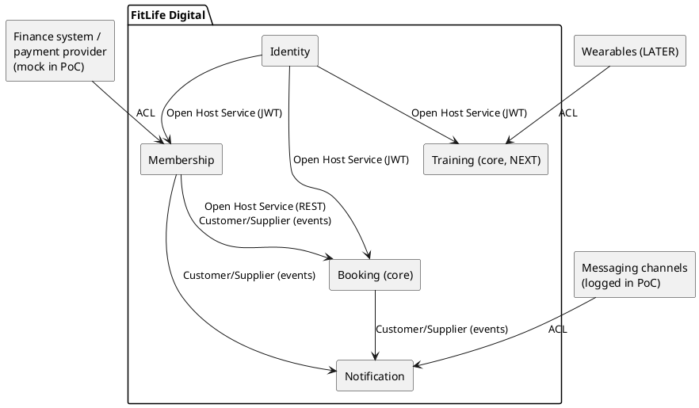

# Context map: FitLife Digital

> **Status:** follows [ADR 007](../adr/007-bounded-contexts.md), which holds the reasons and the alternatives.
> This file is a **group decision**. To change it, open an issue and write an ADR (`METHODOLOGY.md` section 11).
> Method: IT-arkitektur M4, *Læringsguide M4.01* (its examples use the course's practice company HaaV; we apply the method to FitLife) and the worksheet *HaaV-domænemodel (Skabelon)*.

**Sources, short form.** `[PB p. N]` = *F25v Projektbeskrivelse – Fase 1 og 2*. `[M4.01 p. N]` = *Læringsguide M4.01 – HaaVs forretningsdomæne*. `[M10.03]` = *Læringsguide M10.03 – Godkendelse med JWT*. `[I1]`–`[I4]` = the group's four simulated interviews with synthetic informants (27 Oct 2026): I1 Freja, I2 Mikkel, I3 Amira, I4 Jonas. **Group choice** = a design decision of ours, not a fact from the case.

## Three kinds of truth

Agents: keep these apart. Most wrong code comes from mixing them.

| Layer | Question | Example |
|---|---|---|
| The case (AS-IS) | What does FitLife have today? | A membership system from 2012 handles payment and key fobs [PB p. 4] |
| The target architecture (TO-BE) | What have we decided FitLife should have? | Our own Membership and Access contexts, built from scratch. The 2012 system is retired after a one-time migration of the members |
| The PoC | What actually runs in our code? | Our own services, starting with `BookingService`. Everything outside FitLife Digital is a mock: the payment provider and the finance system on a Postman Mock Server [PB p. 9], the messaging channels (mocked or only logged) and wearables (a mock at most). No 2012 system. Until Identity exists, the mock in `tests/postman/mocks/` stands in for account registration |

## 1. Core capability and core subdomains

> **Core capability:** the ability to give every member a personal relationship with the trainers and instructors they know, on classes and in personal training, in the centre and digitally.

| Criterion [M4.01 p. 4] | Met? | Why |
|---|---|---|
| Creates a real competitive advantage | Yes | Skilled trainers with high customer satisfaction and a personal relationship with customers are FitLife's strengths [PB p. 4–5]. Three of four informants name the trainers or instructors as their reason to stay [I1, I3, I4] |
| Hard to copy | Yes | It lives in people and local relationships. The competitors win on price and opening hours [I1, I2] |
| Supports the strategy directly | Yes | The hybrid model must support community, motivation and flexibility "uden at fjerne det menneskelige aspekt" [PB p. 4] |

**Core subdomains (as in the target architecture from part 1):** class scheduling and booking, and personal training. That is the maximum of two [M4.01 p. 5].

**The reverse test** [M4.01 p. 4]: if FitLife did this as well as everyone else, would anyone still choose FitLife? For personal training, clearly yes. For booking, the answer only holds if the argument is the local class with a known instructor, not the booking software: competitors already offer booking in an app [I1]. The report must make that argument. Options B and C and why they were not chosen are in ADR 007.

## 2. Subdomains

**Build or integrate** follows principle P5 in the target architecture from part 1: we build what sets FitLife apart, and buy or integrate the rest through open interfaces. P5 names payment, key fobs, messaging channels and streaming as bought or integrated. In the PoC we build our own services and mock everything external, so a whole flow can be shown without a real supplier (the PoC row in "Three kinds of truth").

| Subdomain | Responsibility | Type | Build / integrate | Why |
|---|---|---|---|---|
| Class scheduling and booking | One class schedule for all six centres; book, cancel, join a waitlist | Core | Build | The local class with a known instructor. Also the informants' biggest shared pain point [I1–I4] |
| Personal training | Programmes, sessions and follow-up between a member and their personal trainer | Core | Build | The relationship with the trainer is the core capability. Today the data lives in each trainer's own Excel sheet [PB p. 4; I2, I3] |
| Membership administration | Join, pause, change and cancel a membership digitally | Supporting | Build from scratch | Replaces the 2012 system's membership part [PB p. 4]. The informants ask for pause and flexible memberships [I3, I4], which the single membership type doesn't offer [PB p. 3] |
| Access control | Who may enter a centre: key fobs and check-ins | Supporting | Build the access rules; integrate the door and key fob system (NEXT) | Replaces the 2012 system's key fob part [PB p. 4], so the new platform can at least do what the old one did. Our context holds who may enter and the check-ins. The door and key fob system is bought or integrated (P5) and asks Access |
| Consent for health data | Members' consent to share training and health data, and a log of who saw it | Supporting | Build together with personal training; minimal in the PoC | Pulse and weight are health data [PB p. 4]. Principle P4 in the target architecture |
| Member communication | Tell the right members about cancellations and changes | Supporting | Build the service; integrate the channels | Who gets a message follows from the bookings. SMS, e-mail and push are external channels (P5); in the PoC they are mocked or only logged |
| Identity and access | Log-in, roles and tokens | Generic | Build simply ourselves | Our own `IdentityService` with JWT, as taught in IT-arkitektur M10 [M10.03]. Small in the PoC: test users and roles |
| Payment and finance | Charging the membership fee, accounting | Generic | Integrate (external) | Outside FitLife Digital (P5). FitLife's finance system and a payment provider; mocked in the PoC with a Postman Mock Server [PB p. 9] |
| Insight | Reports on bookings, attendance and churn per centre | Supporting | Build simply, later | Built on data the other contexts already create |
| Engagement | Challenges, groups and points | Supporting | Later | From the case's idea for FitLife Digital [PB p. 5]; not in the first phases |

At most two subdomains are core: "hvis alt er core, er intet core" [M4.01 p. 5].

## 3. Bounded contexts

One context = one service in `src/<Service>/` = one database. Each context gets its own `src/<Service>/CONTEXT.md` (DDD_PLAN step 3). Phase: NOW = the first phase; NEXT and LATER = later phases (from the TO-BE context document). The PoC starts with `BookingService`; each further service gets its own issue.

| Context | Service | Subdomain(s) | Owns data about | Key terms (see `GLOSSARY.md`) | Phase |
|---|---|---|---|---|---|
| Booking | `BookingService` | Class scheduling and booking (core) | Centres, class types, class sessions, reservations, waitlist entries | Hold, Holdtype, Booking, Ventelisteplads, Instruktør | NOW |
| Training | `TrainingService` | Personal training (core) | Programmes, training sessions, notes | PT-forløb, Træningspas, Personlig træner | NEXT |
| Membership | `MembershipService` | Membership administration | Members, memberships, membership types | Medlem, Medlemskab, Medlemstype | NOW |
| Notification | `NotificationService` | Member communication | Notification preferences, sent notifications | Notifikation | NOW |
| Identity | `IdentityService` | Identity and access | Accounts, roles | Konto, Rolle | NOW (minimal) |
| Consent | – | Consent for health data | Consents and the access log for health data | Samtykke | With Training |
| Access | – | Access control | Key fobs, check-ins | Adgangsbrik, Check-in | NEXT |
| Engagement | – | Engagement | Challenges, groups, points | – | LATER |

**Not bounded contexts:** the member app and web, the trainer portal, the API gateway and the MCP server are channels or platform components. They hold no business rules and call the services above (principle PA3 in the TO-BE context document). The MCP server lets a member's AI assistant use our API. It is LATER in the target architecture; whether the PoC shows it is its own issue.

Other contexts refer to a member only by `MemberId`.

**Sign-up takes two steps.** A person first creates a `Konto` in Identity, and then joins in Membership with the token. Membership keeps the account's id from the token on the `Medlem`. The password never passes through Membership, and no event is needed.

## 4. Relations

Patterns [M4.01 p. 10]: Customer–Supplier, Open Host Service, Anticorruption Layer (ACL), Separate Ways.

| Upstream | Downstream | Pattern | How (REST / event) | Why this pattern |
|---|---|---|---|---|
| Finance system and payment provider | Membership | ACL | REST + callback. A Postman Mock Server in the PoC [PB p. 9] | External systems outside FitLife Digital. Their names and data model stay outside ours |
| Identity | All services | Open Host Service | JWT with roles as claims [M10.03] | Every service checks the same token in the same way |
| Membership | Booking | Open Host Service | REST: "is this member active?" when a reservation is made | Several contexts need the same answer. Synchronous, so nobody books on a membership that just ended (group choice, DDD_PLAN step 7) |
| Membership | Booking | Customer–Supplier | Events: `MembershipPaused`, `MembershipCancelled` | Booking cancels future reservations without Membership knowing what a reservation is |
| Booking | Notification | Customer–Supplier | Events | A reservation must not wait for a message to be sent. Notification follows what Booking publishes |
| Membership | Notification | Customer–Supplier | Events | Same reason |
| Messaging channels (SMS, e-mail, push) | Notification | ACL | Mocked or only logged in the PoC | External channels (P5). Their formats stay outside our model |
| Door and key fob system | Access | ACL | NEXT | Bought or integrated (P5). It asks Access who may enter; its data model stays outside ours |
| Wearables and health apps | Training | ACL | LATER. Described in the report; a mock in the PoC at most | Every vendor has its own data model |
| CRM module | – | Separate Ways | None | Used sporadically today [PB p. 4] and not part of this version |

**The 2012 membership system has no relation at runtime.** Its members are migrated once into Membership during the transition (target architecture part 6). Membership and Access take over from it together, so a new member can always open the door; until then it keeps handling payment and key fobs [PB p. 4]. The migration is not part of the PoC.

## 5. Events that cross a context boundary

Each event gets a JSON Schema in `contracts/events/` and is tested against it in CI. Names are in the past tense (METHODOLOGY 11.2 rule 6). The Danish names are the ones in the TO-BE context document.

| Event (past tense) | Danish name | Published by | Consumed by | What the consumer does | Schema |
|---|---|---|---|---|---|
| `ReservationMade` | BookingOprettet | Booking | Notification | Confirms the reservation, also when it came from the waitlist | `contracts/events/reservation-made.schema.json` |
| `ReservationCancelled` | BookingAfmeldt | Booking | Notification | Confirms the cancellation | `contracts/events/reservation-cancelled.schema.json` |
| `ClassSessionCancelled` | HoldAflyst | Booking | Notification | Tells everyone reserved or waitlisted | `contracts/events/class-session-cancelled.schema.json` |
| `ClassSessionChanged` | HoldÆndret | Booking | Notification | Tells everyone reserved; cancelling is free | `contracts/events/class-session-changed.schema.json` |
| `MembershipPaused` | MedlemskabPauset | Membership | Booking, Notification | Booking cancels reservations and waitlist entries in the period, not as late cancellations | `contracts/events/membership-paused.schema.json` |
| `MembershipCancelled` | MedlemskabOpsagt | Membership | Booking, Notification | Booking cancels reservations after the last training day | `contracts/events/membership-cancelled.schema.json` |
| `PaymentFailed` | BetalingFejlet | Membership | Notification | Tells the member | `contracts/events/payment-failed.schema.json` |

`SeatReleased` (PladsFrigivet) stays inside Booking: moving the first member off the waitlist is Booking's own rule, so it is not a contract between contexts. Training's events are added when Training is modelled (DDD_PLAN step 4).

## 6. Decisions

| Decision | ADR |
|---|---|
| Why these bounded contexts | [`docs/adr/007-bounded-contexts.md`](../adr/007-bounded-contexts.md) |
