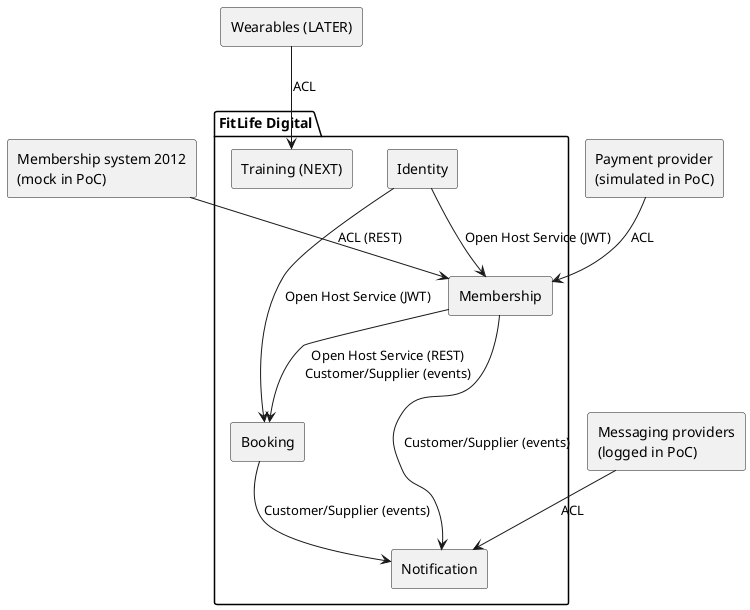

# Context map: FitLife Digital

> **Status: proposed, not decided.** Draft for the group session on issue #2. Which subdomain is core (Q1) is open, so this file shows the options instead of an answer. Nothing here is decided until ADR 007 says `accepted`. The questions the group must answer are in [ADR 007](../adr/007-bounded-contexts.md#questions-for-the-group-session).
> **Agents:** until then, don't build on anything marked Q1–Q7.
> This file is a **group decision**. To change it, open an issue and write an ADR (`METHODOLOGY.md` section 11).
> Method: IT-arkitektur M4, *Læringsguide M4.01* and the worksheet *HaaV-domænemodel (Skabelon)*, applied to FitLife.

**Sources, short form.** `[PB p. N]` = *F25v Projektbeskrivelse – Fase 1 og 2*. `[M4.01 p. N]` = *Læringsguide M4.01 – HaaVs forretningsdomæne*. `[I1]`–`[I4]` = the group's four simulated interviews with synthetic informants (27 Oct 2026): I1 Freja, I2 Mikkel, I3 Amira, I4 Jonas. **Group choice** = a design decision of ours, not a fact from the case.

## Three kinds of truth

Agents: keep these apart. Most wrong code comes from mixing them.

| Layer | Question | Example |
|---|---|---|
| The case (AS-IS) | What does FitLife have today? | A membership system from 2012 handles payment and key fobs [PB p. 4] |
| The target architecture (TO-BE) | What have we decided FitLife should have? | Our own Membership context; the 2012 system is retired later |
| The PoC | What actually runs in our code? | No 2012 system. A Postman Mock Server stands in for it |

## 1. Core capability and core subdomain (Q1 open)

> **Proposed core capability:** the ability to give every member a personal relationship with the trainers and instructors they know, on classes and in personal training, in the centre and digitally.

| Criterion [M4.01 p. 4] | Met? | Why |
|---|---|---|
| Creates a real competitive advantage | Yes | Skilled trainers with high customer satisfaction and a personal relationship with customers are FitLife's strengths [PB p. 4–5]. Three of four informants name the trainers or instructors as their reason to stay [I1, I3, I4] |
| Hard to copy | Yes | It lives in people and local relationships. The competitors win on price and opening hours [I1, I2] |
| Supports the strategy directly | Yes | The hybrid model must support community, motivation and flexibility "uden at fjerne det menneskelige aspekt" [PB p. 4] |

**The reverse test** [M4.01 p. 4]: if FitLife did this as well as everyone else, would anyone still choose FitLife? The test points at the relationship, not at the software that books a seat: competitors already offer booking in an app [I1].

**Which subdomain carries the core capability is open (Q1 in ADR 007).** The options in short:

| Option | Core subdomain(s) | Main argument | Main weakness |
|---|---|---|---|
| A | Class scheduling and booking **and** personal training | Same as the target architecture from part 1; the PoC starts with core (DDD_PLAN step 4) | Weak reverse test for booking |
| B | Personal training only | Clearest reverse test | The PoC builds supporting contexts first |
| C | Class scheduling and booking only; personal training not in this version | Smallest scope | Weak reverse test; the case's personal trainers are left out |

The tables below mark every row that depends on the answer.

## 2. Subdomains

| Subdomain | Responsibility | Type | Build / buy / integrate | Why |
|---|---|---|---|---|
| Personal training | Programmes, sessions and follow-up between a member and their personal trainer | Q1: Core (A, B) / not in this version (C) | Build | The relationship with the trainer is the core capability. Today the data lives in each trainer's own Excel sheet [PB p. 4; I2, I3] |
| Class scheduling and booking | One class schedule for all six centres; book, cancel, join a waitlist | Q1: Core (A, C) / Supporting (B) | Build (simply, if supporting) | The informants' biggest shared pain point [I1–I4]. Core only if the argument is the local class with a known instructor, not the booking software |
| Membership administration | Join, pause, change and cancel a membership digitally | Supporting | Build simply | The informants ask for pause and flexible memberships [I3, I4], which the case's single membership type doesn't offer [PB p. 3] |
| Member communication | Tell the right members about cancellations and changes | Supporting | Build simply, buy the channels | Who gets a message follows from the bookings. Sending SMS, e-mail and push is solved elsewhere |
| Identity and access | Log-in, roles and tokens | Generic | Buy in production; a minimal own service in the PoC (Q3) | Solved by the industry. The PoC must still contain identity and access functionality [PB p. 10] |
| Payment | Charging the membership fee | Generic | Buy / integrate | Solved by the industry. Simulated in the PoC |
| Insight | Reports on bookings, attendance and churn per centre | Supporting | Build simply, later | Built on data the other contexts already create |
| Engagement | Challenges, groups and points | Supporting | Later | From the case's idea for FitLife Digital [PB p. 5]; not in the first phases |

At most two subdomains are core: "hvis alt er core, er intet core" [M4.01 p. 5].

## 3. Bounded contexts

One context = one service in `src/<Service>/` = one database. Each context gets its own `src/<Service>/CONTEXT.md` (DDD_PLAN step 3). Phase: NOW = the first phase and the PoC's scope; NEXT and LATER = later phases (from the TO-BE context document). The phases are a proposal until Q1 and Q7 are answered.

| Context | Service | Subdomain(s) | Owns data about | Key terms (see `GLOSSARY.md`) | Phase |
|---|---|---|---|---|---|
| Booking | `BookingService` | Class scheduling and booking | Centres, class types, class sessions, reservations, waitlist entries | Hold, Holdtype, Booking, Venteliste, Instruktør | NOW |
| Membership | `MembershipService` | Membership administration | Members, memberships, membership types | Medlem, Medlemskab, Medlemstype | NOW |
| Notification | `NotificationService` | Member communication | Notification preferences, sent notifications | Notifikation | NOW |
| Identity | `IdentityService` | Identity and access | Accounts, roles | Konto, Rolle | NOW (minimal, Q3) |
| Training | `TrainingService` | Personal training | Programmes, training sessions, notes | PT-forløb, Træningspas, Personlig træner | Q1: NEXT (A, B) / not in this version (C) |
| Consent | – | Membership administration | Consents and the access log for health data | Samtykke | NEXT |
| Access | – | Membership administration | Check-ins | Check-in | NEXT |
| Engagement | – | Engagement | Challenges, groups, points | – | LATER |

**Not bounded contexts:** the member app and web, the trainer portal, the API gateway and the MCP server are channels or platform components. They hold no business rules and call the services above (principle PA3 in the TO-BE context document). Whether the MCP server is in the PoC is a scope question, not a domain question (Q4).

Other contexts refer to a member only by `MemberId`.

## 4. Relations

Patterns [M4.01 p. 10]: Customer–Supplier, Open Host Service, Anticorruption Layer (ACL), Separate Ways.

| Upstream | Downstream | Pattern | How (REST / event) | Why this pattern |
|---|---|---|---|---|
| Membership system (2012) | Membership | ACL | REST lookup. In the PoC a Postman Mock Server | The case requires integration with the existing membership and finance systems [PB p. 5]. A system from 2012 must not decide how our model sees a member. The layer translates and is removed when the old system is retired (Q2) |
| Payment provider | Membership | ACL | REST + callback. Simulated in the PoC | Generic and bought. Its names stay outside our model |
| Identity | All services | Open Host Service | JWT with roles as claims | Every service checks the same token in the same way |
| Membership | Booking | Open Host Service | REST: "is this member active?" when a reservation is made | Several contexts need the same answer. Synchronous, so nobody books on a membership that just ended (group choice, DDD_PLAN step 7) |
| Membership | Booking | Customer–Supplier | Events: `MembershipPaused`, `MembershipCancelled` | Booking cancels future reservations without Membership knowing what a reservation is |
| Booking | Notification | Customer–Supplier | Events | A reservation must not wait for a message to be sent. Notification follows what Booking publishes |
| Membership | Notification | Customer–Supplier | Events | Same reason |
| Messaging providers (SMS, e-mail, push) | Notification | ACL | REST. In the PoC messages are only logged | Generic and bought |
| Wearables and health apps | Training | ACL | Asynchronous import (LATER) | Every vendor has its own data model |
| CRM module | – | Separate Ways | None | Used sporadically today [PB p. 4] and not integrated in this version |

## 5. Events that cross a context boundary

Each event gets a JSON Schema in `contracts/events/` and is tested against it in CI. Names are in the past tense (METHODOLOGY 11.2 rule 6). The Danish names are the ones in the TO-BE context document.

| Event (past tense) | Danish name | Published by | Consumed by | What the consumer does | Schema |
|---|---|---|---|---|---|
| `ReservationMade` | BookingOprettet | Booking | Notification | Confirms the reservation, also when it came from the waitlist | `contracts/events/reservation-made.schema.json` |
| `ReservationCancelled` | BookingAfmeldt | Booking | Notification | Confirms the cancellation | `contracts/events/reservation-cancelled.schema.json` |
| `ClassSessionCancelled` | HoldAflyst | Booking | Notification | Tells everyone reserved or waitlisted | `contracts/events/class-session-cancelled.schema.json` |
| `ClassSessionChanged` | HoldÆndret | Booking | Notification | Tells everyone reserved; cancelling is free | `contracts/events/class-session-changed.schema.json` |
| `MembershipPaused` | MedlemskabPauset | Membership | Booking, Notification | Booking cancels reservations and waitlist entries in the period, not as late cancellations | `contracts/events/membership-paused.schema.json` |
| `MembershipCancelled` | MedlemskabOpsagt | Membership | Booking, Notification | Booking cancels reservations after the last training day | `contracts/events/membership-cancelled.schema.json` |
| `PaymentFailed` | BetalingFejlet | Membership | Notification | Tells the member | `contracts/events/payment-failed.schema.json` |

`SeatReleased` (PladsFrigivet) stays inside Booking: moving the first member off the waitlist is Booking's own rule, so it is not a contract between contexts.

## 6. Decisions

| Decision | ADR |
|---|---|
| Why these bounded contexts | [`docs/adr/007-bounded-contexts.md`](../adr/007-bounded-contexts.md) |
